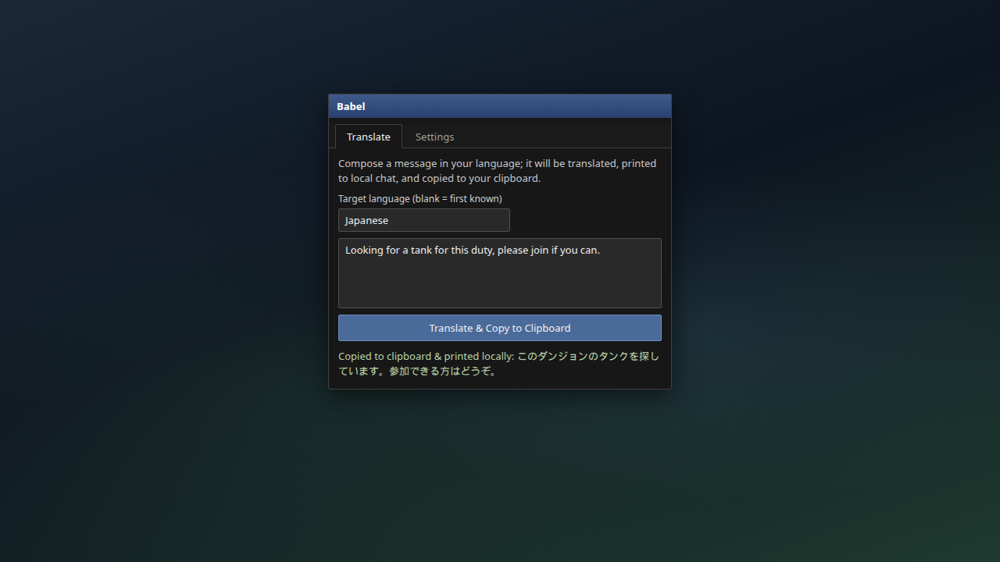
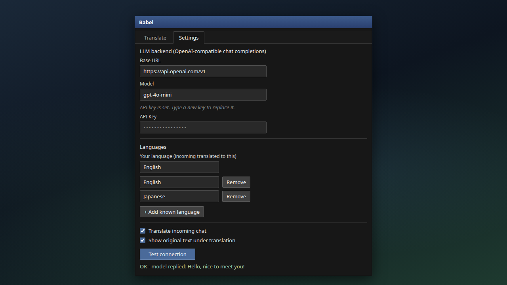
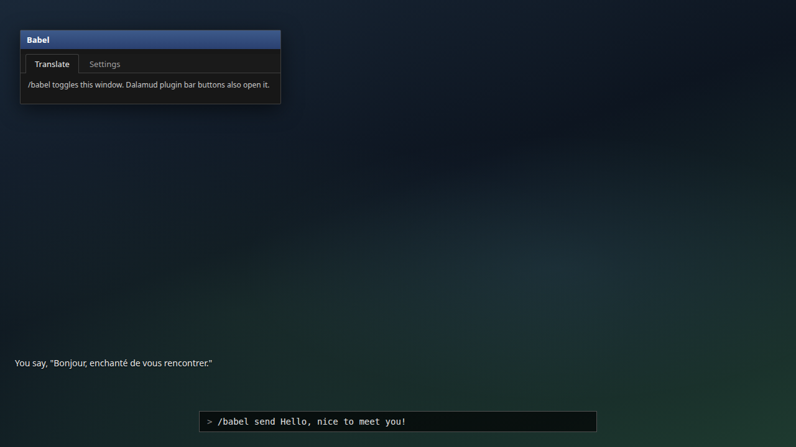

# Babel14

Two-way in-game chat translation for FFXIV, powered by any OpenAI-compatible LLM API.

`/babel` · Dalamud API 15 · .NET 10

## What it does

- **Incoming** — foreign chat in watched channels is translated to your language as a follow-up line, with the original underneath when enabled.
- **Outgoing** — compose in the window or `/babel send <text>`; the translation goes to **local** chat, and from the window also to the clipboard for pasting into the game chat box.
- **Any OpenAI-compatible endpoint** — OpenAI, DeepSeek, OpenRouter, or a local llama.cpp / LM Studio / KoboldCpp server.

## Screenshots

Screenshots are mock-ups illustrating the UI, not captures from the live game.

| | |
| --- | --- |
|  | **Translate tab** — compose outgoing text, optional target language, **Translate & Copy to Clipboard** (prints local Say and copies the translation). |
|  | **Settings tab** — Base URL, Model, API Key, your language, known languages (+ Add / Remove), behaviour checkboxes, **Test connection**. |
|  | **Incoming translation** — foreign line in chat, then the plugin’s follow-up with **Show original text under translation** (`[babel …]` line). |
|  | **`/babel send`** — command entry and translated line printed locally (Say); **`/babel`** toggles the window (Dalamud main/config plugin buttons do the same). |

HTML sources for regenerating PNGs: `docs/screenshots/src/` (`node render.mjs` after `npm install playwright` and `npx playwright install chromium` in that folder).

### Feature coverage (UI and commands)

| Feature | Shown in |
| --- | --- |
| `/babel` — toggle Babel window | [04-babel-send-command.png](docs/screenshots/04-babel-send-command.png) (window open); also [01](docs/screenshots/01-translate-tab.png), [02](docs/screenshots/02-settings-tab.png) |
| Dalamud **Open Main UI** / **Open Config UI** plugin buttons (same toggle) | [04-babel-send-command.png](docs/screenshots/04-babel-send-command.png) (caption) |
| **Translate** tab — multiline compose, target language field, **Translate & Copy to Clipboard**, status text | [01-translate-tab.png](docs/screenshots/01-translate-tab.png) |
| **`/babel send &lt;text&gt;`** — outgoing translate to first known language ≠ your language, local Say | [04-babel-send-command.png](docs/screenshots/04-babel-send-command.png) |
| **Translate incoming chat** (watched `XivChatType` channels) | [03-incoming-chat.png](docs/screenshots/03-incoming-chat.png); toggle in [02-settings-tab.png](docs/screenshots/02-settings-tab.png) |
| **Show original text under translation** | [03-incoming-chat.png](docs/screenshots/03-incoming-chat.png); checkbox in [02-settings-tab.png](docs/screenshots/02-settings-tab.png) |
| **LLM backend** — Base URL, Model, API Key (password field; “API key is set…” hint) | [02-settings-tab.png](docs/screenshots/02-settings-tab.png) |
| **Languages** — your language (incoming target), known-language list, **+ Add known language**, **Remove** | [02-settings-tab.png](docs/screenshots/02-settings-tab.png) |
| **Test connection** (fixed greeting; OK / Failed result text) | [02-settings-tab.png](docs/screenshots/02-settings-tab.png) |
| **Watched channels** list (config file only, no in-game UI) | README / config — not pictured |

## How it works

Messages from `IChatGui.ChatMessage` whose `LogKind` is in `WatchedChannels` (raw `XivChatType` values; default Say 10, Shout 13, Yell 14, TellIncoming 58, Party 18, Alliance 20) are translated one at a time behind a semaphore; up to 8 queue and the rest are dropped.

Each call is one `POST {BaseUrl}/chat/completions` with the model, `temperature 0.1` and a system prompt that keeps tone, names and `<t>` emotes and asks for the translation only. Without a key no Bearer header is sent; requests time out after 20 s.

Printed lines are recorded in an own-message tracker (256 entries, cleared on overflow) so the echoed chat line is not translated again.

## Commands

| Command | Effect |
| --- | --- |
| `/babel` | Toggle the window (also the plugin's main and config UI buttons). |
| `/babel send <text>` | Translate into your first known language that is not your own; printed locally, never sent to other players. |

## Settings

- **LLM backend** — base URL (default `https://api.openai.com/v1`), model (default `gpt-4o-mini`), API key; edits apply and save at once.
- **Languages** — your language (incoming target) and an editable known-language list (first entry is the default outgoing target, overridable per message).
- **Behaviour** — translate incoming chat, show original underneath.
- **Test connection** — one fixed greeting through the model; needs a key.

## Build

Requires the .NET 10 SDK and the Dalamud dev distribution
(`%APPDATA%\XIVLauncher\addon\Hooks\dev`, or `DALAMUD_HOME`). The plugin build excludes
`Babel14.Tests/`, so the test project never ends up in the zip.

```
dotnet build -c Debug      # load bin/Debug/Babel14.dll as a dev plugin
dotnet build -c Release    # zip in bin/Release/Babel14/latest.zip
```

## Install (dev plugin)

1. `/xlsettings` → Experimental → Dev Plugin Locations → add `bin\Debug\Babel14.dll`.
2. `/xlplugins` → Dev Tools → enable **Babel14**.
3. `/babel` opens the window; settings live in its Settings tab.

## Tests

`OwnMessageTracker` is tested offline without Dalamud (the test project links `Services/OwnMessageTracker.cs`): exact matches, no insert on lookup, both printed forms marked but not the original, overflow keeps only the latest.

```
dotnet test Babel14.Tests/Babel14.Tests.csproj    # 6 tests, all pass
```

## Security

- **The API key is stored in plaintext** in the Dalamud plugin config on disk (normal for Dalamud plugins). Treat the config directory like a secrets store.
- **Base URL is fully user-controlled**, so you can point at local or third-party OpenAI-compatible servers. Prefer HTTPS for remote endpoints: a mis-set URL sends chat text and your Bearer token to whatever host you configure, including LAN services on the game PC.
- Chat text is sent to the configured LLM provider for translation.

## Limits

- Watched channels are config-file only, with no UI.
- One translation at a time; lines arriving beyond 8 pending are skipped.
- Empty or unchanged replies are suppressed, not printed.
- Not verified in game: behaviour is taken from the code and the offline tests, not from a live client.

## Layout

```
Plugin.cs                     entry point, /babel handler, plugin services
Configuration.cs              saved settings (URL, model, key, languages, channels)
Services/ChatTranslator.cs    chat hook, queueing, incoming/outgoing prompts
Services/LlmClient.cs         OpenAI-compatible client, test call, 20 s timeout
Services/OwnMessageTracker.cs de-duplication of lines the plugin printed
Windows/BabelWindow.cs        Translate and Settings tabs
Babel14.Tests/             xUnit tests for OwnMessageTracker
```
